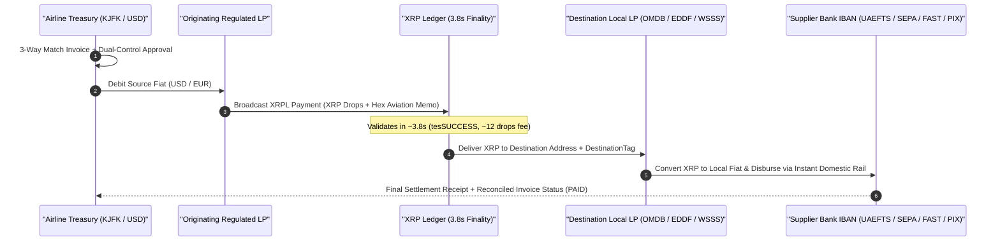
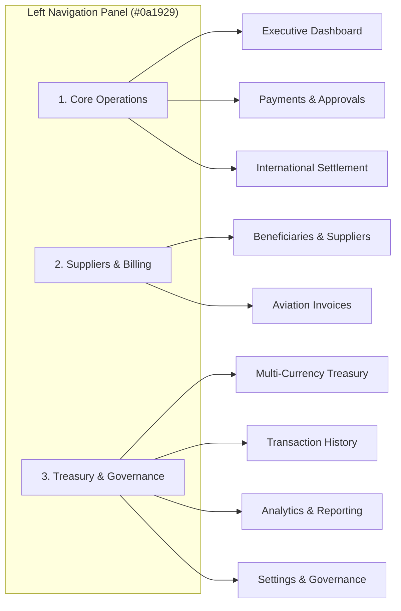

# AeroSettle — Aviation Industry & Platform Walkthrough

**AeroSettle** is an enterprise B2B aviation payment, treasury orchestration, and cross-border settlement operating system powered by the **XRP Ledger (XRPL)**. It is built to solve one of commercial aviation's most expensive operational bottlenecks: **slow, pre-funded cross-border supplier settlements across international airport hubs**.

---

## 1. The Aviation Industry Problem AeroSettle Solves

Commercial airlines, cargo operators, and charter fleets operate aircraft across dozens of international jurisdictions every day. Every flight depends on time-critical local suppliers at foreign airports:

| Aviation Operational Domain | Real-World Settlement Pain Point | How AeroSettle Resolves It |
| :--- | :--- | :--- |
| **Into-Plane Jet A-1 Fuel Uplift** (`FUEL_SUPPLIER`) | International fuel suppliers at hubs like Dubai (`OMDB`) require either costly pre-funded local escrow deposits or charge high credit spreads because cross-border SWIFT wires take 24–48 hours. | Settles fuel uplift invoices (`LITERS` / `USG`) in **~18 seconds** via XRPL On-Demand Liquidity (`XRPL_BRIDGE`) into the supplier's local bank IBAN over domestic instant rails (`UAEFTS`), eliminating pre-funded fuel escrows. |
| **AOG (Aircraft on Ground) Spare Parts** (`PARTS_DISTRIBUTOR`) | A grounded widebody aircraft costs an airline `$100,000+` per day. Foreign avionics/rotable distributors often hold shipment of an AOG part until international wire funds clear. | Provides **~14-second settlement** (`KLAX -> WSSS` Singapore via XRPL + Singapore `FAST`) with cryptographic on-ledger proof (`tesSUCCESS`) and hex-encoded aircraft tail & invoice metadata so AOG parts ship immediately. |
| **Airframe & Engine MRO Overhaul** (`MRO_FACILITY`) | Heavy C/D-checks and engine overhaul reserve payments (`$100k–$1M+`) to EASA/FAA MRO facilities (`EDDF` Frankfurt) suffer `45–65 bps` bank FX spreads and multi-day clearing delays. | Compresses USD-to-EUR MRO settlements to **~12 seconds** (`11 bps` spread) via XRPL/RLUSD + `SEPA Instant` (`RT1/TIPS`), while enforcing CFO/Approver dual-control governance on high-value disbursements. |
| **Ground Handling, Ramp & De-Icing** (`GROUND_HANDLING`) | High-friction emerging-market corridors like Brazil (`SBGR` São Paulo) require local FX registration and take 48+ hours via correspondent banking (`115 bps` spread). | Routes through a BACEN-authorized eFX liquidity partner (`XRPL_BRIDGE` -> Brazil `PIX`), cutting settlement time to **~26 seconds** and FX spread to `24 bps`. |
| **ACMI Wet-Leasing & Airport Slots** (`AIRCRAFT_LEASING`) | Cross-currency European lease and slot settlements (`EHAM -> EGLL` London, `EUR -> GBP`) incur correspondent bank hops and cutoff windows. | Bridges `EUR -> XRP -> GBP` with instant `UK Faster Payments (FPS)` credit in **~11 seconds** (`10 bps` spread), 24/7/365 including weekends and holidays. |

> [!IMPORTANT]
> **Regulatory Realism Built Into the Architecture:** AeroSettle does not claim that XRP bypasses banking laws or directly replaces a supplier's local bank account. Instead, XRP (or `RLUSD`) replaces the slow **cross-border correspondent Nostro/Vostro hop** between regulated institutional liquidity providers, while final payout to the aviation supplier occurs in local fiat (`AED`, `EUR`, `SGD`, `BRL`, `GBP`) over domestic instant banking rails.

---

## 2. End-to-End 4-Stage Aviation Settlement Architecture

Implemented in [`src/services/payment-rails.ts`](src/services/payment-rails.ts) and [`src/services/xrpl-service.ts`](src/services/xrpl-service.ts), every cross-border XRPL bridge settlement flows through four distinct stages:

### Canonical Aviation Hex Memo Encoding on XRPL
When AeroSettle constructs an XRPL `Payment` payload in [`src/services/xrpl-service.ts`](src/services/xrpl-service.ts), it embeds structured aviation operational metadata directly into the XRPL `Memos` array (`MemoType: aviation/settlement`, `MemoFormat: application/json`):
- **`ref`**: AeroSettle Payment Reference (e.g., `PAY-2026-8841`)
- **`inv`**: Matched Supplier Invoice Number (e.g., `INV-DXB-2026-1042`)
- **`tail`**: Aircraft Tail Registration (e.g., `N789AS`)
- **`icao`**: Airport Station ICAO Code (e.g., `OMDB`, `EDDF`, `WSSS`, `SBGR`, `EGLL`)

This allows airline treasury auditors and supplier accounting systems to cryptographically tie an on-chain XRPL transaction directly to a specific aircraft tail, airport uplift station, and invoice.

---

## 3. Configured International Aviation Corridors

AeroSettle models six international aviation corridors in [`src/services/payment-rails.ts`](src/services/payment-rails.ts) — five active XRPL corridors and one explicitly unsupported corridor to demonstrate realistic liquidity and compliance guardrails:

| Origin → Destination Hub | Pair | Primary Aviation Use Case | XRPL Bridge Speed & Spread | Legacy Wire Speed & Spread | Local Domestic Off-Ramp Rail |
| :--- | :--- | :--- | :--- | :--- | :--- |
| `KJFK` New York → `OMDB` Dubai | `USD → AED` | Jet A-1 Hydrant Fuel Uplift | **18 sec** (`14 bps`, `$15` fee) | 24 hrs (`65 bps`, `$85` fee) | `UAEFTS` (Central Bank of UAE) |
| `KJFK` New York → `EDDF` Frankfurt | `USD → EUR` | Airframe C/D-Check & Engine MRO | **12 sec** (`11 bps`, `$12` fee) | 12 hrs (`48 bps`, `$65` fee) | `SEPA Instant` (`RT1 / TIPS`) |
| `KLAX` Los Angeles → `WSSS` Singapore | `USD → SGD` | AOG Rotables & Avionics Spares | **14 sec** (`12 bps`, `$12` fee) | 20 hrs (`55 bps`, `$75` fee) | `Singapore FAST` |
| `KMIA` Miami → `SBGR` São Paulo | `USD → BRL` | Ground Handling, Ramp & Landing | **26 sec** (`24 bps`, `$22` fee) | 48 hrs (`115 bps`, `$120` fee) | `Brazil PIX` (via BACEN eFX LP) |
| `EHAM` Amsterdam → `EGLL` London | `EUR → GBP` | ACMI Wet-Lease & Heathrow Slots | **11 sec** (`10 bps`, `$10` fee) | 8 hrs (`42 bps`, `$55` fee) | `UK Faster Payments (FPS)` |
| `KJFK` New York → `UAAA` Almaty | `USD → KZT` | Polar Cargo Tech-Stop Refueling | **Unsupported on XRPL** | 72 hrs (`140 bps`, `$145` fee) | Traditional SWIFT Correspondent Only |

> [!NOTE]
> **Why `KJFK -> UAAA` (`USD -> KZT`) Is Modeled as Unsupported:** In real aviation operations, not every currency has deep XRPL orderbook liquidity or a licensed local digital-asset off-ramp partner. When an operator selects `KZT` with `XRPL_BRIDGE`, AeroSettle flags the corridor as restricted and guides the operator to route via traditional `SWIFT_GPI` with manual compliance review.

---

## 4. Walkthrough of the 9 Platform Modules (Left Navigation Panel)

The UI in [`src/app/page.tsx`](src/app/page.tsx) is organized into three functional groups in the left navigation panel:

### Group 1: Core Operations

1. **Executive Dashboard ([`src/app/page.tsx`](src/app/page.tsx))**
   - **8 Fleet Financial KPIs:** Total Transaction Volume, Outbound Supplier Settlements, Inbound Interline/ACMI Receivables, Average Settlement Time (`14 seconds`), Active Approval Queue count, Completed Settlements (`100% Recon`), Multi-Currency Treasury Exposure, and Unpaid Aviation Invoices.
   - **Monthly Rail Velocity Chart:** Visual comparison of XRPL Bridge & `RLUSD` volume against legacy SWIFT wires.
   - **Hub & Currency Exposure Breakdown:** Tracks settlement distribution across `GBP` (`EGLL`), `EUR` (`EDDF`), `AED` (`OMDB`), `SGD` (`WSSS`), and `BRL` (`SBGR`).
   - **Live Compliance & Operational Feed:** Surfaces action-required alerts (such as dual-control sign-offs or overdue fuel uplift invoices) with one-click deep links to the relevant module.

2. **Payments & Approvals ([`src/app/page.tsx`](src/app/page.tsx))**
   - **2-Step Modular Aviation Settlement Builder (`1. Configure -> 2. Review & Confirm`):**
     - Select a verified aviation supplier (auto-populates default currency, airport ICAO station, and preferred settlement rail).
     - Optionally link an unpaid invoice for **automatic 3-way reconciliation**.
     - Choose between 5 payment rail adapters: `XRPL_BRIDGE`, `RLUSD_STABLECOIN`, `SWIFT_GPI`, `SEPA_INSTANT`, or `FEDWIRE`.
     - Tag the payment with **Aircraft Tail Number** (e.g., `N789AS`) and **Airport Station ICAO** (e.g., `OMDB`).
   - **Real-Time FX & XRPL Quote Engine:** Continuously calculates mid-market FX rate, applied corridor spread (`bps`), exact XRP bridge units (`10^-6` drops precision via [`src/lib/decimal.ts`](src/lib/decimal.ts)), network fee (`12 drops`), and downstream clearing partner.
   - **Dual-Control Approval Queue:** Payments exceeding the airline's dual-control threshold (default `$50,000 USD`) can be queued as `AWAITING_APPROVAL` for a `PAYMENT_APPROVER`, `FINANCE_MANAGER`, or `ADMINISTRATOR` to approve or reject, or settled immediately by an authorized role.

3. **International Settlement ([`src/components/SettlementAndTreasuryViews.tsx`](src/components/SettlementAndTreasuryViews.tsx))**
   - **Interactive Corridor Matrix:** Click any of the 6 international airport corridors to compare XRPL Bridge vs. `RLUSD` vs. `SWIFT_GPI` / `SEPA_INSTANT`, or click **Send on Corridor** to pre-load that corridor into the Payment Builder.
   - **XRPL Service Environment Switcher:** Toggle between:
     - `SIMULATION_SANDBOX` (isolated local execution — never fabricates fake 64-hex on-chain hashes; marks records with `SIM-XRPL-...` trace IDs).
     - `XRPL_TESTNET` (connects to live Ripple Altnet JSON-RPC `https://s.altnet.rippletest.net:51234/`).
     - `XRPL_MAINNET` (connects to live XRPL Mainnet JSON-RPC `https://xrplcluster.com/`).
   - **On-Chain XRPL Transaction Hash Verifier (`tx` RPC):** Paste any 64-character hex XRPL hash (or a `SIM-XRPL-...` simulation trace ID) to verify whether a transaction is genuinely validated on the XRP Ledger (`tesSUCCESS`) or is an isolated simulation record.

---

### Group 2: Suppliers & Billing

4. **Beneficiaries & Suppliers ([`src/app/page.tsx`](src/app/page.tsx))**
   - Searchable directory of verified international aviation counterparties filtered by category:
     - `FUEL_SUPPLIER` (e.g., *GulfJet Into-Plane Fuel Services Dubai* at `OMDB`, IATA Fuel Code `GJF-DXB-01`)
     - `MRO_FACILITY` (e.g., *RheinMain AeroTechnik MRO* at `EDDF`, Cert `EASA.145.0412`)
     - `PARTS_DISTRIBUTOR` (e.g., *Changi AeroSpares & Avionics* at `WSSS`, Cert `FAA-PMA-SG-882`)
     - `GROUND_HANDLING` (e.g., *Aeroporto Paulista Ground Services* at `SBGR`)
     - `AIRCRAFT_LEASING` (e.g., *Thames Aviation Capital & Leasing* at `EGLL`)
   - Stores both traditional banking coordinates (`IBAN`, `SWIFT BIC`) and XRPL settlement coordinates (`Classic r-Address` validated via base58 regex + `DestinationTag`), plus `KYB` verification and `OFAC/EU/UN` sanctions screening status.
   - Includes an **Onboard International Aviation Supplier** modal with XRPL classic address validation.

5. **Aviation Invoices ([`src/app/page.tsx`](src/app/page.tsx))**
   - Tracks itemized aviation invoices (`OUTSTANDING`, `OVERDUE`, `PENDING_APPROVAL`, `PAID`) with line-item quantities (`LITERS`, `HOURS`, `UNIT`), aircraft tail number, flight number, airport ICAO code, and a SHA-256 PDF document integrity hash.
   - **One-Click Pay & Reconcile:** Clicking **Pay & Reconcile →** on any unpaid invoice loads the exact supplier, currency, invoice reference, tail number, and USD equivalent into the Payment Builder. Once settled, the invoice automatically transitions to `PAID` and links to the payment record.

---

### Group 3: Treasury & Governance

6. **Multi-Currency Treasury ([`src/components/SettlementAndTreasuryViews.tsx`](src/components/SettlementAndTreasuryViews.tsx))**
   - Explicitly separates custody classifications so institutional treasurers and auditors have zero ambiguity:
     - `EXTERNAL_BANK_LINKED`: Read-only Open Banking / SWIFT MT940 balances held at JPMorgan Chase (`USD`), Deutsche Bank (`EUR`), and Emirates NBD (`AED`).
     - `NON_CUSTODIAL_XRPL_SIGNER`: Airline's own AWS KMS / HSM hardware-signed XRPL accounts (`1,425,000 XRP` with explicit `1.0 XRP` base reserve and `0.4 XRP` owner reserve breakdown).
     - `EXTERNAL_CUSTODY_VAULT`: Regulated institutional `RLUSD` trustline liquidity (`1,250,000 RLUSD`).

7. **Transaction History ([`src/app/page.tsx`](src/app/page.tsx))**
   - Multi-filter searchable ledger (filter by text/ICAO, destination currency, country, payment rail, status, and minimum USD amount).
   - **Audit Receipt Inspector ([`src/components/PaymentConfirmationModal.tsx`](src/components/PaymentConfirmationModal.tsx)):** Clicking **Inspect Record** opens the full confirmation modal displaying the Execution Classification badge (`SIMULATED_PAYMENT`, `SUBMITTED_BLOCKCHAIN_TX`, `VALIDATED_ON_CHAIN_TX`, or `COMPLETED_EXTERNAL_FIAT_SETTLEMENT`), XRP drops conversion, raw canonical XRPL transaction JSON, cryptographic approval signatures, and one-click **JSON Audit Receipt** download.
   - **CSV Ledger Export:** Exports the currently filtered ledger to CSV for ERP/SAP aviation accounting import.

8. **Analytics & Reporting ([`src/components/AnalyticsAndSettingsViews.tsx`](src/components/AnalyticsAndSettingsViews.tsx))**
   - Quantifies executive treasury performance: `14.2 sec` average XRPL settlement vs. `38.4 hrs` legacy SWIFT, `13.5 bps` weighted FX spread (`~54 bps` saved), `$148,920` YTD FX & wire fee savings, regional volume breakdown, and per-supplier settlement velocity table with full CSV report export.

9. **Settings, RBAC & Audit Trail ([`src/components/AnalyticsAndSettingsViews.tsx`](src/components/AnalyticsAndSettingsViews.tsx))**
   - **Entity Governance Policy:** Configure the airline's legal name, primary ICAO hub, and Dual-Control Approval Threshold (`USD`).
   - **Interactive 5-Role RBAC Switcher:** Test live server-enforced permissions across 5 aviation finance roles:
     - `ADMINISTRATOR` (CFO — full governance & unlimited approval up to `$10M`)
     - `FINANCE_MANAGER` (VP Fleet Treasury — create/approve up to `$2.5M`, manage suppliers)
     - `PAYMENT_APPROVER` (Settlement Director — approve/release queued payments up to `$1M`, cannot initiate payments)
     - `FINANCE_OPERATOR` (AP & Fuel Analyst — draft payments & upload invoices, `$0` approval limit — must route to approval queue)
     - `READ_ONLY_AUDITOR` (External SOX/Aviation Auditor — read-only inspection & audit exports; all mutations blocked server-side)
   - **Immutable SHA-256 Hash-Chained Audit Trail:** Every state mutation computes a cryptographic SHA-256 digest chained to the previous audit record (`prevHash|action|entityId|summary`).

---

## 5. Moving From Demo Sandbox to Live Aviation Production

> [!TIP]
> Out of the box, AeroSettle runs in **Isolated Simulation & Demo Mode** (`SIMULATION_SANDBOX`) using local JSON persistence ([`data/aerosettle-db.json`](data/aerosettle-db.json)) so anyone can evaluate all 9 aviation modules without external API keys.

To transition the platform to live institutional operation:
1. **PostgreSQL + Prisma Persistence:** Point `DATABASE_URL` in `.env` to a managed PostgreSQL instance using the 17-model schema in [`prisma/schema.prisma`](prisma/schema.prisma).
2. **XRPL KMS / HSM Server Signer:** Set `XRPL_EXECUTION_MODE=XRPL_TESTNET` (or `XRPL_MAINNET`) and configure an isolated server-side HSM/KMS signer (`XRPL_SERVER_SIGNER_SEED`) to broadcast signed `Payment` transactions to the XRP Ledger.
3. **Regional Off-Ramp Liquidity Partners:** Connect commercial API credentials for licensed regional off-ramp partners (`VARA/ADGM` in UAE for `UAEFTS`, `MiCA` in Germany for `SEPA Instant`, `MAS MPI` in Singapore for `FAST`, and `BACEN eFX` in Brazil for `PIX`).
